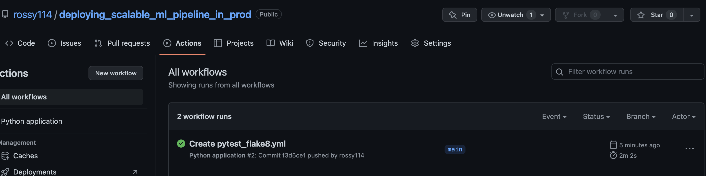
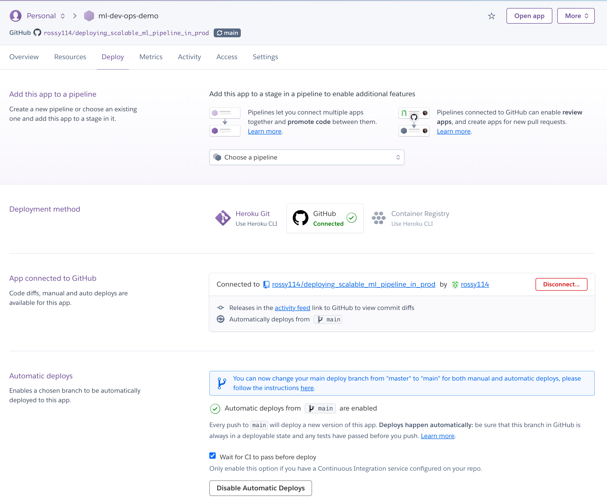
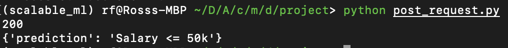

# Census Income Classifier: ML Pipeline to Production API

An end-to-end ML project: train a classifier on US census data, check it for performance gaps across demographic groups, and serve it as a tested, CI-checked **FastAPI** REST API.

> Originally built for the Udacity **Machine Learning DevOps Engineer** Nanodegree (project 3). Refactored in 2026.

## Highlights

- **Reproducible training pipeline**: preprocessing (one-hot encoding plus label binarization), a random forest classifier, and versioned model artefacts (`model/`).
- **Slice-based evaluation**: precision, recall and F1 are computed for every value of every categorical feature (`slice_output.txt`) to surface groups where the model underperforms. See the [model card](model_card.md).
- **Production API**: FastAPI with Pydantic validation, the model loaded once at startup, and auto-generated OpenAPI docs at `/docs`.
- **Tested & automated**: pytest covers the data, model and API layers. GitHub Actions runs flake8 and the tests on every push.

## Results (held-out 20% test set)

| Precision | Recall | F1 |
|---|---|---|
| 0.781 | 0.651 | 0.710 |

## Quickstart

```bash
python -m venv .venv && source .venv/bin/activate
pip install -r requirements.txt

python -m ml.train_model     # train and save model/, prints test metrics
python evaluate.py           # per-slice metrics -> slice_output.txt
pytest                       # run the test suite
uvicorn main:app --reload    # serve the API at http://127.0.0.1:8000/docs
```

Example request:

```bash
curl -X POST http://127.0.0.1:8000/predict \
  -H "Content-Type: application/json" \
  -d '{"age": 45, "workclass": "Private", "fnlgt": 160000, "education": "Doctorate",
       "education_num": 16, "marital_status": "Married-civ-spouse", "occupation": "Prof-specialty",
       "relationship": "Husband", "race": "White", "sex": "Male", "capital_gain": 15024,
       "capital_loss": 0, "hours_per_week": 50, "native_country": "United-States"}'
# {"prediction": ">50K"}
```

## Project structure

```
ml/
  config.py        # paths, label and categorical feature list
  data.py          # load, split and preprocess data
  model.py         # train, evaluate, save and load the model
  train_model.py   # training entry point
  test_model.py    # unit tests
main.py            # FastAPI app
test_main.py       # API tests
evaluate.py        # slice-based evaluation
model/             # trained model, encoder and label binarizer
model_card.md      # model card: intended use, metrics, limitations
.github/workflows/ # CI: lint + tests
```

## Deployment

The app was originally deployed to Heroku with continuous deployment from `main`. The `Procfile` is still included. Heroku has since ended its free tier, so the screenshots below are from that deployment.

| CI passing | Continuous deployment | Live POST request |
|---|---|---|
|  |  |  |

**Stack:** Python · scikit-learn · pandas · FastAPI · Pydantic · pytest · GitHub Actions
